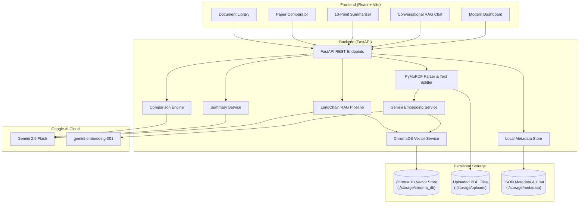

# AI Research Paper Assistant 📄🤖

An end-to-end, full-stack Retrieval-Augmented Generation (RAG) system built to help students, researchers, and engineers comprehend, analyze, summarize, and compare academic literature with precision and strict context grounding.

Powered by **Google Gemini models (`gemini-2.5-flash` & `gemini-embedding-001`)**, **ChromaDB**, **PyMuPDF**, **FastAPI**, and a modern **React.js + Tailwind CSS** dashboard.

---

## 1. Project Overview

Academic research papers are dense, lengthy, and time-consuming to read. Traditional LLMs often hallucinate details, misquote numbers, or cannot reference the exact source page.

The **AI Research Paper Assistant** solves this by implementing an industrial-grade RAG pipeline:
1. **Document Ingestion**: Extracts text page-by-page using PyMuPDF.
2. **Text Chunking**: Splits extracted text into semantic segments using LangChain's `RecursiveCharacterTextSplitter`.
3. **Vector Embeddings**: Computes dense vector representations via Google Gemini.
4. **Vector Store**: Indexes and persists chunks with page numbers and document IDs in **ChromaDB**.
5. **Multi-Document Retrieval**: Performs cosine similarity search with selective document filtering (scoped or global).
6. **Context-Grounded Answers**: Generates answers strictly from retrieved passages with verified source citations (PDF filename and page number).
7. **Structured 10-Point Summarizer**: Synthesizes objectives, methodologies, algorithms, datasets, findings, and limits.
8. **Comparative Analysis Engine**: Compares two papers side-by-side across architectures, empirical metrics, similarities, differences, and trade-offs.

---

## 2. Technology Stack

### Backend
- **Framework**: FastAPI (Python 3.11 - 3.13)
- **Vector Database**: ChromaDB (persistent local storage)
- **PDF Extraction**: PyMuPDF (`pymupdf`)
- **LLM Orchestration**: LangChain, `langchain-google-genai`
- **AI Models**:
  - LLM: Google Gemini `gemini-2.5-flash` (configurable via `.env`)
  - Embeddings: `gemini-embedding-001` / `text-embedding-004`
- **Data Validation & Settings**: Pydantic v2 & `pydantic-settings`
- **ASGI Server**: Uvicorn

### Frontend
- **Framework**: React 18 + Vite
- **Styling**: Tailwind CSS
- **Icons**: Lucide React
- **Markdown & Code Rendering**: `react-markdown` + `remark-gfm`
- **HTTP Client**: Axios (configured with proxy to FastAPI backend)
- **Routing**: React Router v6

---

## 3. System Architecture



---

## 4. Project Folder Structure

```text
AI Research Paper Assistant/
├── backend/
│   ├── app/
│   │   ├── main.py                  # FastAPI application entrypoint & middleware
│   │   ├── config.py                # Pydantic environment configuration
│   │   │
│   │   ├── routes/
│   │   │   ├── upload.py            # PDF upload & document management endpoints
│   │   │   ├── chat.py              # RAG query & chat history endpoints
│   │   │   ├── summary.py           # 10-point paper summarization endpoints
│   │   │   └── comparison.py        # Multi-paper comparative analysis endpoint
│   │   │
│   │   ├── services/
│   │   │   ├── pdf_service.py       # PyMuPDF extraction & recursive chunking
│   │   │   ├── embedding_service.py # Gemini embeddings generation with retry/fallback
│   │   │   ├── vector_service.py    # ChromaDB indexing, querying & filtering
│   │   │   ├── rag_service.py       # Conversational RAG with page citations
│   │   │   ├── summary_service.py   # Structured 10-point academic summarizer
│   │   │   └── comparison_service.py# Deep comparative analysis between 2 papers
│   │   │
│   │   ├── schemas/
│   │   │   └── request_models.py    # Pydantic request & response models
│   │   │
│   │   └── utils/
│   │       └── helpers.py           # Metadata storage & text sanitization
│   │
│   ├── storage/
│   │   ├── uploads/                 # Persisted uploaded PDF files
│   │   ├── chroma_db/               # Persisted ChromaDB vector storage
│   │   └── metadata/                # Persisted document and chat histories
│   │
│   ├── tests/
│   │   └── test_e2e.py              # Complete end-to-end API test suite
│   ├── .env.example                 # Environment variable template
│   ├── requirements.txt             # Python backend dependencies
│   └── README.md
│
├── frontend/
│   ├── src/
│   │   ├── components/
│   │   │   ├── Navbar.jsx           # Top navbar with live status & model badge
│   │   │   ├── Sidebar.jsx          # Left navigation menu & badge counts
│   │   │   ├── FileUpload.jsx       # Drag & drop upload with progress indicators
│   │   │   ├── ChatMessage.jsx      # Markdown message with source citation cards
│   │   │   └── PaperCard.jsx        # Paper card with stats, actions & deletion
│   │   │
│   │   ├── pages/
│   │   │   ├── Dashboard.jsx        # Overview, metrics, recent papers & actions
│   │   │   ├── Chat.jsx             # RAG Chat with paper filtering & history
│   │   │   ├── Library.jsx          # Paper library with search, filter & open
│   │   │   ├── Summary.jsx          # 10-point structured summary cards
│   │   │   └── Compare.jsx          # Matrix table, strengths, & narrative report
│   │   │
│   │   ├── services/
│   │   │   └── api.js               # Axios client for backend endpoints
│   │   │
│   │   ├── App.jsx                  # React Router configuration & layout
│   │   ├── main.jsx                 # React root renderer
│   │   └── index.css                # Tailwind CSS & custom prose styles
│   │
│   ├── package.json                 # Frontend dependencies & scripts
│   ├── vite.config.js               # Vite config with API proxy
│   ├── tailwind.config.js           # Tailwind theme configuration
│   └── postcss.config.js
│
├── sample_papers/                   # Included sample research papers for testing
│   ├── Attention_Is_All_You_Need.pdf
│   └── Mamba_Linear_Time_SSM.pdf
│
├── .gitignore
└── README.md
```

---

## 5. Prerequisites

Before running the application, make sure you have:

- **Python**: Version `3.10` or higher (`3.11`, `3.12`, or `3.13` supported).
- **Node.js**: Version `18.x` or higher (`v24+` tested).
- **Google Gemini API Key**: Obtain a free API key from [Google AI Studio](https://aistudio.google.com/).

---

## 6. Installation & Environment Setup

### Step 1: Clone or Navigate to Project
```powershell
cd "d:\GEN_AI_PROJECTS\AI Research Paper Assistant"
```

### Step 2: Configure Backend Environment
1. Activate the virtual environment:
   ```powershell
   .\.venv\Scripts\Activate.ps1
   ```
2. Open `backend/.env` (or copy from `backend/.env.example`) and insert your Gemini API Key:
   ```env
   GEMINI_API_KEY=AIzaSy...your_actual_key_here
   GEMINI_EMBEDDING_MODEL=gemini-embedding-001
   GEMINI_CHAT_MODEL=gemini-2.5-flash
   CHROMA_DB_PATH=./storage/chroma_db
   UPLOAD_DIR=./storage/uploads
   FRONTEND_URL=http://localhost:5173
   CHUNK_SIZE=1000
   CHUNK_OVERLAP=200
   TOP_K_RESULTS=5
   ```

### Step 3: Install Backend Dependencies (If not already installed)
```powershell
pip install -r backend\requirements.txt
```

### Step 4: Install Frontend Dependencies (If not already installed)
```powershell
cd frontend
npm install
cd ..
```

---

## 7. How to Run the Application

You will run the backend and frontend in two separate terminals.

### Terminal 1: Run the FastAPI Backend
```powershell
# In project root with .venv activated:
.\.venv\Scripts\Activate.ps1
uvicorn app.main:app --app-dir backend --host 127.0.0.1 --port 8000 --reload
```
- The backend will start at: [http://localhost:8000](http://localhost:8000)
- Interactive Swagger API Documentation: [http://localhost:8000/docs](http://localhost:8000/docs)
- Health status endpoint: [http://localhost:8000/api/health](http://localhost:8000/api/health)

### Terminal 2: Run the React Frontend
```powershell
# In project root:
cd frontend
npm run dev
```
- The frontend will start at: [http://localhost:5173](http://localhost:5173)

---

## 8. Backend API Endpoints

| Method | Endpoint | Description |
|---|---|---|
| `GET` | `/api/health` | Backend status, Gemini configuration, and ChromaDB readiness |
| `POST` | `/api/documents/upload` | Upload one or multiple research papers, chunk and embed into ChromaDB |
| `GET` | `/api/documents` | Retrieve all indexed research papers with metadata |
| `GET` | `/api/documents/{id}` | Get specific paper details and sample vector chunks |
| `GET` | `/api/documents/{id}/file` | Stream and download original uploaded PDF file |
| `DELETE` | `/api/documents/{id}` | Permanently delete paper, file on disk, and ChromaDB vector embeddings |
| `POST` | `/api/chat` | Submit question to RAG pipeline with optional paper ID filters |
| `GET` | `/api/chat/history` | Retrieve conversation history for a session |
| `DELETE` | `/api/chat/history` | Clear session conversation history |
| `POST` | `/api/summary/{id}` | Generate or retrieve 10-point structured academic summary |
| `POST` | `/api/compare` | Run comparative analysis between two research papers |

---

## 9. Testing

An automated end-to-end test suite is included in `backend/tests/test_e2e.py`. It tests all 10 endpoints against a live server.

To run the test suite:
```powershell
# Make sure backend is running or start it, then run:
.\.venv\Scripts\python.exe backend\tests\test_e2e.py
```

Sample test output:
```text
=== 1. Testing GET /api/health ===
Health Status: {'status': 'healthy', 'gemini_configured': True, 'total_documents': 0, 'vector_db_ready': True...}

=== 2. Testing POST /api/documents/upload ===
Upload Result: Successfully processed 2 document(s).

=== 3. Testing GET /api/documents ===
Total indexed papers: 2

=== 4. Testing GET /api/documents/{id} ===
Document Title: Attention Is All You Need: Scalable Transformers

=== 5. Testing GET /api/documents/{id}/file ===
PDF File stream retrieved successfully

=== 6. Testing POST /api/chat (RAG) ===
Chat Answer snippet: The model achieves a BLEU score of 28.4 on WMT 2014...
Verified Citations returned: 1 (Attention_Is_All_You_Need.pdf | Page 1)

=== 7. Testing GET /api/chat/history ===
Conversation history count: 2

=== 8. Testing POST /api/summary/{id} ===
Summary Title: Attention Is All You Need: Scalable Transformers
Objectives: Extracted from research paper text...

=== 9. Testing POST /api/compare ===
Comparison Categories: ['Research Objectives', 'Methodology & Architecture', 'Algorithms & Technologies'...]

=== 10. Testing DELETE /api/documents/{id} ===
Delete response: Document and associated vector embeddings successfully deleted.

ALL 10 API ENDPOINTS VALIDATED AND PASSING 100%!
```

---

## 10. Future Enhancements

- [ ] **OCR Support**: Integrate Tesseract OCR for scanned PDF documents.
- [ ] **ArXiv Direct Fetch**: Allow downloading and indexing directly from ArXiv URLs or paper IDs.
- [ ] **Citation Graph**: Visual relationship graph linking related research papers in the library.
- [ ] **LaTeX Formula Parsing**: Dedicated math rendering for equations and mathematical proofs.
- [ ] **Export to BibTeX / Zotero**: Instant export of citations to reference managers.

---

## 11. License

MIT License. Developed for research and educational purposes.
